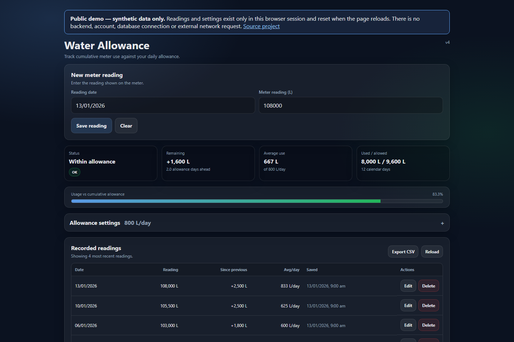

# Water Allowance Tracker

A small full-stack application that records cumulative water meter readings, calculates daily consumption, and compares it with an allowance. Built with Node.js, Express, vanilla JavaScript, and MySQL.

**Portfolio preparation copy:** sample dates and readings are synthetic. No production credentials, database exports, or personal readings are required.

## Features

- Create, update, delete, list and CSV-export meter readings
- Compare cumulative use against a configurable daily allowance
- Validate calendar dates and cumulative meter chronology
- Preserve the date of measurement separately from save time
- Store baseline and allowance settings in MySQL
- Support private access through HTTP Basic authentication

## Local setup

Requires Node.js 22+ and MySQL 8-compatible database.

1. Create an isolated database and least-privilege user.
2. Apply `schema.sql`, and optionally `examples/sample-readings.sql` for **synthetic data only**.
3. Copy `.env.example` to `.env` and supply local DB credentials and APP_USERNAME/APP_PASSWORD.
4. Run `npm ci`, `npm test`, `npm run check` and `npm start`.
5. Open `http://localhost:3000` and enter your local authentication credentials.

Explicit `APP_AUTH_ENABLED=false` binds the web server to loopback only for local development. Do not expose an unauthenticated instance to the internet.

## Example

Synthetic baseline: 100,000 L on 1 January 2026. Daily allowance: 800 L. Reading: 103,000 L on 6 January 2026. Five calendar days allow 4,000 L; 3,000 L consumed leaves 1,000 L.

## Architecture

The static frontend and API share one Express process. HTTP routes live in `src/routes`, database interactions in `src/services` and `src/db`, validation in `src/lib`, and the reusable calculator in `public/assets/calculations.js`.

Endpoints: `GET /ping` (public process health), `GET /api/health` (authenticated database health), `GET /api/readings`, `POST /api/readings`, `PATCH /api/readings/:id`, `DELETE /api/readings/:id`, `GET /api/readings/export.csv`, `GET /api/settings`, `PUT /api/settings`.

Example reading input: `{"readingDate":"2026-01-06","reading":103000}`.

## Engineering decisions and limitations

Calendar-day calculations use UTC dates to avoid NZ daylight-saving transition errors. The application validates cumulative readings against their neighbours. A unique constraint protects exact duplicate date/value records on fresh databases, but chronology validation is not yet atomic under concurrent writes. The rate limiter is per-process and not a distributed anti-abuse service. A full MySQL-backed integration suite and safely isolated browser demo are future improvements.

**Security:** never copy the original private repository's Git history. It previously contained configuration secrets. Build the public repository from a reviewed snapshot with a completely new history. Do not expose real household data or production infrastructure. HTTPS is required for remote Basic Auth.

**Publication status:** candidate only, not yet approved for public visibility. Complete tests, dependency installation, secret audit, and licence selection first.
