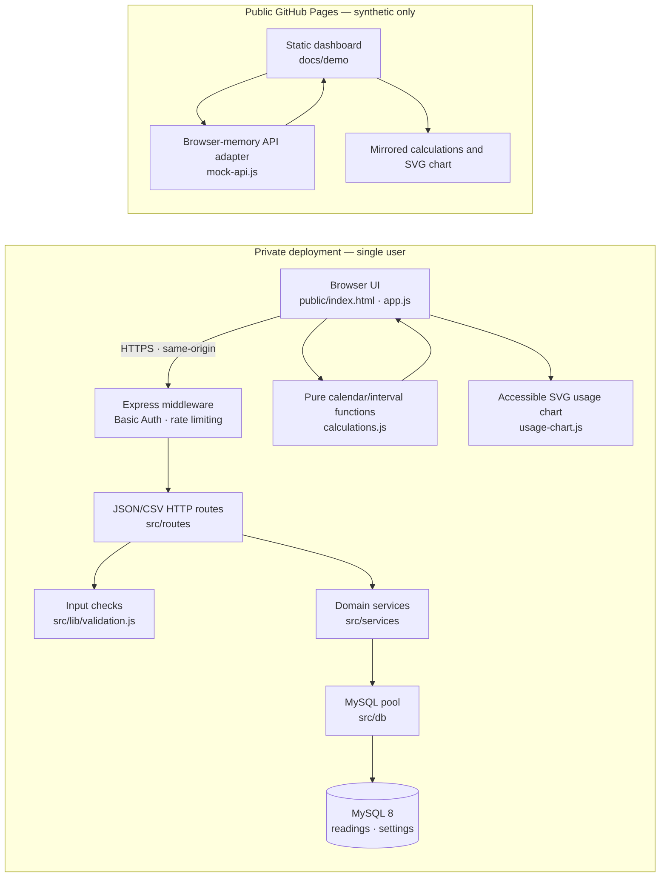
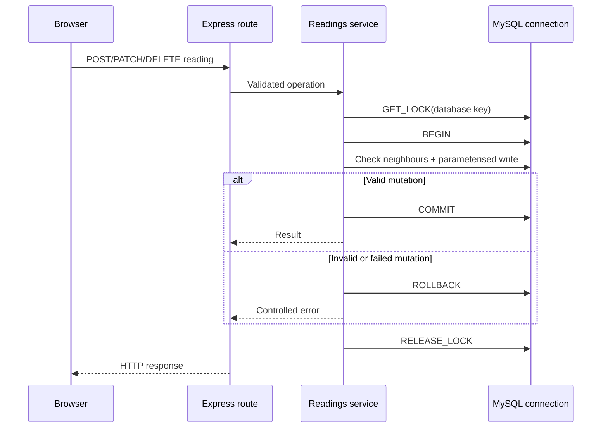

# Water Allowance Tracker — Architecture and engineering decisions

## System at a glance

The private application is a small same-origin **Node.js/Express and MySQL**
service. The public GitHub Pages demo is a **different, static deployment**:
it reuses the browser UI and calculation code but replaces API requests with an
in-memory synthetic-data adapter. No production credentials, database or
private deployment endpoints are packaged in the public demo.

**Security boundary:** the static demo has no path to the MySQL pool. It
does not call a remote API, and its readings disappear when the page reloads.
The real deployment's middleware and MySQL account are separate.

## Write flow and chronology consistency

1. Basic Auth protects private routes (apart from the deliberately public
   `/ping` liveness check). Routes validate typed inputs and send bounded
   operations to the readings service.
2. Every cooperating create/update/delete mutation acquires a **MySQL
   connection-scoped advisory lock** keyed to the database, then starts a
   transaction on the **same pooled connection**.
3. The service queries neighbouring cumulative readings, rejects inversions
   and exact duplicate date/value pairs, and performs parameterised SQL.
4. It commits on success or rolls back on an error, then explicitly releases
   the advisory lock. The connection is discarded if rollback or release
   cannot be trusted.
5. A unique index on date/value provides a separate database safeguard for
   exact duplicates. The API returns controlled conflict/error responses.

The lock serialises only writers participating in this protocol. Independent
SQL connections bypassing the advisory lock are **not** covered. The limiter
is in-process, not shared across multiple server instances. The current
design is single-user, not multi-tenant.

## Calendar-day calculation and interval chart

The allowance uses cumulative meter readings, **not instantaneous daily
consumption**. For a reading pair:

- `elapsedDays = UTC calendar days between observation dates`
- `litresUsed = current cumulative reading − previous cumulative reading`
- `averagePerDay = litresUsed / elapsedDays`, for positive elapsed days
- Compare each interval's average with the configured daily allowance.

The application uses UTC calendar-day arithmetic after parsing NZ-style
`dd/mm/yyyy` values, avoiding daylight-saving 23/25-hour distortions.

The bar chart displays the **eight most recent measured intervals**, with a
dashed line for the daily allowance and a contrasting bar colour when an
interval's average exceeds it. The first interval may use the configured
baseline. Same-day observations are combined using the highest cumulative
reading for that date rather than dividing by zero. When the API's 200-reading
limit is reached, the chart does not invent a baseline-to-oldest period.
Invalid or decreasing meter history produces an error state rather than a
misleading plot.

Each bar provides exact dates, elapsed days and litres through its SVG
title/accessible interval list. The chart uses local SVG and DOM operations,
no external CDN or charting library.

## Application boundaries

| Layer | Responsibility |
| --- | --- |
| `public/assets/app.js` | DOM and form interactions, API request handling, history UI, chart refresh |
| `public/assets/calculations.js` | Validated allowance/interval calculations; pure, unit-testable |
| `public/assets/usage-chart.js` | Accessible SVG rendering of already calculated intervals |
| `src/middleware/*` | HTTP Basic Auth, response/security constraints, rate limiting |
| `src/routes/*` | HTTP contract, status mapping, JSON/CSV responses |
| `src/lib/validation.js` | Date, numeric input and identifier validation |
| `src/services/*` | Domain operations, chronology checks and transactional writes |
| `src/db/*` | MySQL connection pool |
| `docs/demo/assets/mock-api.js` | Synthetic-only browser implementation of supported HTTP routes |

## Authentication and deployment limits

Basic Auth over HTTPS is a practical private single-user gate, **not** a
replacement for multi-user identity management, account recovery, audit
provenance or roles. It must not be exposed over plain HTTP. Authentication
defaults to enabled and requires credentials. Explicit local no-auth mode
binds to loopback. Trusted proxy settings require careful configuration.

A public live demo is **static**, with synthetic memory-only data. No private
production database, Hostinger configuration or access tokens are used. The
real private application's deployment state is independent of GitHub Pages.

## Verification and outstanding risks

GitHub Actions uses standard no-additional-cost public runners. It performs
`npm ci`, unit tests, syntax checks, a Chrome browser workflow for the demo
and real MySQL 8 integration tests against an isolated disposable database.

[Integration testing evidence](testing.md) includes rollback after real
statements, concurrent chronology conflicts, duplicate-index protection,
authentication rejection and controlled failures/recovery. The browser
regression suite checks responsive sizes, CRUD/settings behaviour, SVG chart
rendering, and absence of external requests.

CI passing verifies this repository revision on the runner, **not** that a
private live database was migrated or that production runtime health was
checked. The static GitHub Pages build has its own deployment verification.
The advisory lock does not guard out-of-band SQL writers; a distributed
application would need a different coordination model.
